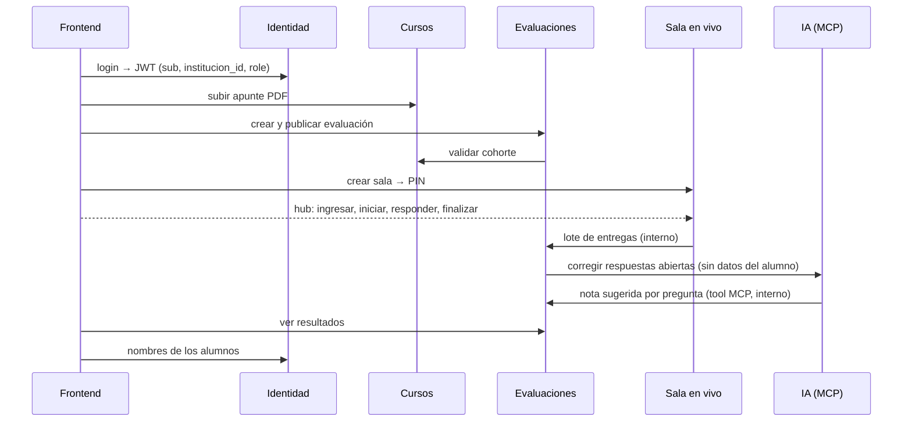

# Contratos de Tiza

Un **contrato** describe exactamente cómo se habla con un servicio: qué se le puede pedir,
con qué datos, qué responde y qué errores devuelve. Es lo que permite que cinco equipos
trabajen en paralelo sin adivinar lo que espera el otro, y lo que leen las IA (la de
corrección por MCP y las que usamos para programar) para entender cómo se conecta todo.

Si vas a programar algo que **otro servicio o el frontend va a usar**, o vas a **usar algo
de otro**, empezá por acá.

## Regla: contrato primero

Desde el Sprint 2 (decisión del PO, issue #165):

1. Toda tarea que conecta dos servicios arranca con **una PR que solo contiene el contrato**.
2. Esa PR la aprueban **el que ofrece** el endpoint y **el que lo consume**.
3. Recién después se programa, contra el contrato. El frontend puede trabajar con mocks
   generados desde el contrato mientras el backend se construye.
4. Si al programar descubrís que el contrato no sirve, **no lo cambies en silencio**: abrí
   una PR que modifique el contrato y avisá al otro lado.

Las operaciones que todavía no están implementadas llevan `"x-estado": "planificado"`.
Las diferencias conocidas entre el contrato y el código actual están en `"x-brechas"`.

## Qué hay en esta carpeta

| Carpeta | Tipo de contrato | Para qué |
| --- | --- | --- |
| `openapi/` | OpenAPI 3.0 | Pedidos HTTP de cada microservicio |
| `schemas/` | JSON Schema 2020-12 | La forma exacta de un dato que viaja entre servicios |
| `signalr/` | Documento Markdown + schemas | Métodos y eventos en tiempo real del hub de la sala |

## Mapa: quién ofrece y quién consume

| Contrato | Archivo | Ofrece | Consume |
| --- | --- | --- | --- |
| Login, sesión y token | `openapi/identidad-v1.json` | Identidad | Frontend |
| **Claims del JWT** | `openapi/identidad-v1.json` → `JwtInstitucional` | Identidad | **Los 5 servicios** |
| Usuarios por rol *(planificado)* | `openapi/identidad-v1.json` → `/api/usuarios` | Identidad (#91) | Frontend: cohortes, matrículas, resultados |
| Alta masiva de alumnos *(planificado)* | `openapi/identidad-v1.json` → `/api/usuarios/alumnos/importacion` | Identidad (#135) | Frontend |
| Cursos, cohortes y matrículas | `openapi/cursos-v1.json` | Cursos | Frontend |
| Validar cohorte | `openapi/cursos-v1.json` → `/api/v1/cohortes/{id}/validacion` | Cursos | Evaluaciones (#145) |
| Alumnos por cohorte | `openapi/cursos-v1.json` → `GET /api/v1/cohortes/{id}/matriculas` | Cursos | Frontend, Sala en vivo |
| Material PDF *(planificado)* | `openapi/cursos-v1.json` → `/materiales` | Cursos (#137) | Frontend (#138) |
| Texto del apunte *(planificado, interno)* | `openapi/cursos-v1.json` → `/api/v1/materiales/{id}/texto` | Cursos (#137) | IA (S3-IA-01) |
| Evaluaciones (borrador y publicación) | `openapi/evaluaciones-v1.json` | Evaluaciones | Frontend |
| Preguntas y rúbrica | `schemas/preguntas-v1.schema.json` | Evaluaciones | Sala en vivo, IA, Frontend |
| Crear sala | `openapi/sala-en-vivo-v1.json` | Sala en vivo | Frontend (#141) |
| Hub de la sala (en vivo) | `signalr/sala-hub-v1.md` | Sala en vivo | Frontend (#141, #142) |
| Respuesta del alumno | `schemas/enviar-respuesta-sala-v1.schema.json` y `resultado-envio-respuesta-sala-v1` | Sala en vivo | Frontend (#142) |
| **Lote de entregas** *(planificado, interno)* | `schemas/lote-entregas-v1.schema.json`, `resultado-lote-entregas-v1` y `evaluaciones-v1.json` → `/interno/salas/{salaId}/entregas` | Evaluaciones (#143) | Sala en vivo (#140) |
| Corrección con IA | `openapi/ia-v1.json` → `/api/v1/Correcciones` | IA | Evaluaciones (#144) |
| **Nota sugerida** *(planificado, interno)* | `openapi/evaluaciones-v1.json` → `/interno/entregas/{entregaId}/calificacion-sugerida` | Evaluaciones (#144) | IA, tool MCP `RegistrarCalificacionSugerida` (#146) |
| Resultados de un examen *(planificado)* | `openapi/evaluaciones-v1.json` → `/api/v1/evaluaciones/{id}/entregas` | Evaluaciones (#147) | Frontend (#148) |

## Cómo se conecta todo en la demo

## Reglas que valen para todos los contratos

- **Institución:** sale siempre del claim `institucion_id` del token, nunca del cuerpo ni de
  un header. Un recurso de otra institución responde **404**, no 403, para no revelar que existe.
- **Roles:** claim `role` con `Administrador`, `Docente` o `Alumno`. Los servicios configuran
  `MapInboundClaims=false`, `NameClaimType=sub` y `RoleClaimType=role`.
- **Datos personales:** entre servicios viaja solo el `alumnoId` (claim `sub`). Nombre y email
  se piden a Identidad. **A la IA nunca le llegan datos del alumno.**
- **Endpoints internos** (`/interno/...` y los marcados como internos): son entre servicios y
  no se publican en el gateway.
- **Errores:** `ProblemDetails` (`application/problem+json`) con un `title` legible en español.
- **Reintentos:** quien reintenta reutiliza la misma clave (`idempotencyKey`, `loteId`) y el
  servidor no duplica.
- **Nota sugerida contra nota final:** lo que propone la IA se llama y se muestra siempre como
  *sugerida*. La nota final la aprueba el docente.

## Versiones

- La versión va en el nombre del archivo: `-v1`.
- **Se puede hacer en v1:** agregar endpoints, campos opcionales o códigos de error. El que
  consume ignora lo que no conoce.
- **Requiere v2:** quitar o renombrar campos, cambiar tipos o el significado de un valor.
  Se crea `-v2` y `-v1` convive hasta que todos los consumidores migran.

## Cómo se verifica

El workflow **QA-06 · Contratos** (`.github/workflows/qa06-contratos.yml`, ver
`tests/contracts/README.md`) corre en cada PR:

- valida que todos los OpenAPI de `openapi/` estén bien escritos;
- valida ejemplos contra los JSON Schema (hoy `preguntas-v1`; los del lote se suman en S2-QA-01, #150);
- levanta los servicios, captura su Swagger real y lo compara con estos contratos. Una ruta
  planificada aparece como *SIN IMPLEMENTACION* hasta que se programa.

Pasar el CI demuestra que el contrato está bien escrito, **no que los dos lados estén de
acuerdo**: eso lo da la aprobación de la PR.
