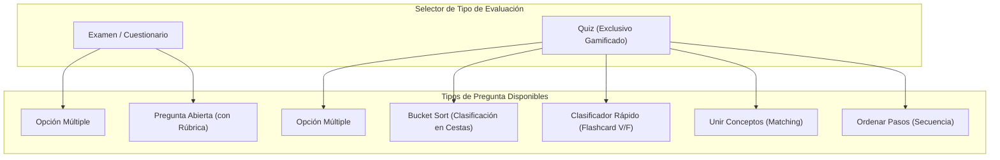

# Acuerdos de Diseño y Especificación Técnica: Spike UX Quizes Gamificados

**Proyecto:** PEI (Tiza) — Plataforma de Evaluación Institucional  
**Rama:** `spike/ux-quizes-gamificados`  
**Fecha:** Noviembre 2026  
**Sesión:** Alineación y Cierre de *Grill-Me*  
**Destinatarios:** Equipo de Desarrollo Frontend, Docentes y Evaluadores  
**Documento de Referencia Base:** `ESPECIFICACION_QUIZ_BUCKET_SORT_Y_CLASIFICADOR_RAPIDO.md`

---

## 1. Resumen Ejecutivo y Objetivos del Spike

A 3 días del *Code Freeze* del Sprint 3, se formalizó la decisión de gestión de mantener las dinámicas gamificadas fuera del alcance del backend para preservar la estabilidad de la entrega y los 161 tests unitarios en verde.

En esta rama de spike (`spike/ux-quizes-gamificados`), implementamos un **prototipo funcional simulado en el Frontend** gobernado por `VITE_USE_MOCKS=true`. Este spike permite:
1. Validar la experiencia de usuario (UX) interactiva y táctil antes de consolidar esquemas en base de datos.
2. Demostrar solvencia técnica ante la cátedra en la presentación final mostrando dinámicas de alta gamificación con estilos oficiales de Tiza.
3. Garantizar **cero impacto en producción**: cuando el flag `VITE_USE_MOCKS` esté en `false`, el sistema se conecta exclusivamente al backend real sin rastros de simulación.



---

## 2. Decisiones de Diseño y Alcance Acordadas (Grill-Me)

Durante la sesión interactiva de *grill-me*, se resolvieron y acordaron las siguientes decisiones de arquitectura y UX:

### 2.1. Exclusividad por Tipo de Evaluación
* **Evaluaciones tipo `Quiz`:**
  * Catálogo completo de dinámicas ágiles: **Opción Múltiple**, **Bucket Sort**, **Clasificador Rápido**, **Unir Conceptos** y **Ordenar Pasos**.
  * **Exclusión explícita:** El tipo `Quiz` **no admite preguntas abiertas ni rúbricas docentes**, manteniendo el foco en evaluación rápida y determinística.
* **Evaluaciones tipo `Examen` o `Cuestionario`:**
  * Conservan estrictamente los tipos tradicionales: **Opción Múltiple** y **Pregunta Abierta**. Las dinámicas gamificadas no aparecen en su selector para evitar confusiones de evaluación formal.

### 2.2. Experiencia en el Editor Docente (`FormularioEvaluacion` / `EditorPregunta`)
* **Plantilla precargada editable por defecto:**  
  Al hacer clic en «+ Agregar pregunta» y cambiar el selector a cualquier dinámica gamificada, la pregunta se inicializa de forma automática con **5 ítems/afirmaciones precargadas sobre arquitectura y clean code**, y un puntaje sugerido de **1.5 puntos** (5 ítems $\times$ 0.3 pts).
* **Control dedicado de puntaje unitario editable:**  
  En cada dinámica (Bucket Sort, Clasificador Rápido y Unir Conceptos), el docente cuenta con un control/input numérico dedicado para editar cuánto vale cada respuesta correcta (por defecto `0.3`, pero modificable libremente). El puntaje total de la pregunta se sincroniza automáticamente: $\text{Puntaje Máximo} = \text{Ítems} \times \text{Puntaje Unitario}$.
* **Beneficio para la Demo:** El docente no pierde tiempo escribiendo textos extensos en vivo; puede mostrar la creación y edición de inmediato, ajustando los puntos de cada concepto con un simple clic.

### 2.3. Experiencia en la Sala Alumno (`TarjetaPregunta`)
* **Validación previa al envío:** El botón «Enviar respuesta» permanece deshabilitado hasta que el alumno haya clasificado o respondido **la totalidad de los ítems** de la dinámica.
* **Feedback estricto sin nota visible:** Al enviar, se muestra la pantalla estándar de confirmación:  
  *«Tu respuesta fue enviada. Esperá a que tu docente pase a la próxima pregunta.»*  
  La nota numérica permanece oculta hasta el cierre de la sala, emulando la confidencialidad de los exámenes reales.

### 2.4. Reglas de Ponderación y Puntajes por Tipo de Quiz

| Tipo de Pregunta | Regla de Calificación | Valor por Defecto | Configurabilidad en Editor Docente |
| :--- | :--- | :---: | :--- |
| **Opción Múltiple** | Puntaje fijo a la opción correcta | Configurado | Input general de puntaje máximo de la pregunta. |
| **Bucket Sort (Cestas)** | Granular ($\text{Aciertos} \times \text{Puntos Unitarios}$) | **0.3 pts** / ítem (1.5 pts total con 5 ítems) | **Editable:** Control dedicado para definir el valor de cada ítem clasificado correctamente. |
| **Clasificador Rápido (V/F)** | Granular ($\text{Aciertos} \times \text{Puntos Unitarios}$) | **0.3 pts** / acierto (1.5 pts total con 5 afirmaciones) | **Editable:** Control principal dedicado para setear el puntaje de cada respuesta correcta. |
| **Unir Conceptos (Matching)** | Granular ($\text{Pares Acertados} \times \text{Puntos Unitarios}$) | **0.3 pts** / par (1.5 pts total con 5 pares) | **Editable:** Control dedicado para definir el puntaje de cada concepto emparejado correctamente. |
| **Ordenar Pasos (Secuencia)** | **Todo o Nada (Binario)**: Secuencia 100% correcta suma el total; si hay error, suma **0**. | **1.0 pt** (total si acierta todo, 0 si falla) | **Editable:** Input de puntaje total de la secuencia completa (sin puntaje parcial). |

### 2.5. Estrategia de Demo y PINs de Prueba (`conexionDemo.ts`)
* **PIN `777777` (Exclusivo Demo Quiz):** Entra directamente a la sala con el recorrido gamificado completo de 5 preguntas sobre Redes y Telecomunicaciones (una de cada tipo):
  1. Pregunta 1: **Bucket Sort** (Protocolos clasificados en Capa de Aplicación vs Red y Transporte).
  2. Pregunta 2: **Clasificador Rápido** (5 flashcards V/F sobre modulación, frecuencia, espectro y fibra óptica).
  3. Pregunta 3: **Unir Conceptos** (Matching entre conceptos de modulación/capa física y sus definiciones).
  4. Pregunta 4: **Ordenar Pasos** (Secuencia cronológica de capas del Modelo OSI de inferior a superior).
  5. Pregunta 5: **Opción Múltiple** (Protocolo confiable orientado a conexión: TCP vs UDP).
* **PIN `123456` (Examen Tradicional):** Se conserva 100% intacto con su flujo habitual de 2 preguntas (Opción Múltiple y Pregunta Abierta), permitiendo al equipo contrastar ambos tipos de evaluación frente al tribunal.

---

## 3. Identidad Visual y Estilos Tailwind Oficiales de Tiza

Para garantizar cohesión estética con el resto de la plataforma, todas las interfaces gamificadas utilizan estrictamente las clases y tokens del tema Tiza definidos en `tailwind.config.js`:

| Token | Valor Hex | Uso en Dinámicas Gamificadas |
| :--- | :--- | :--- |
| `tiza-bosque` | `#123F36` | Textos principales, encabezados (`font-heading`), fichas activas |
| `tiza-pasto` | `#2F7D5B` | Bordes activos, botones afirmativos, cesta Clean Architecture |
| `tiza-menta` | `#E3F2DC` | Fondos de cestas, contenedor de éxito, badges de selección |
| `tiza-borde` | `#DCE5EC` | Bordes sutiles de tarjetas y contenedores |
| `tiza-lima` | `#C8F051` | Resaltado de ficha seleccionada en mazo móvil (`ring-tiza-bosque`) |
| `tiza-coral` | `#FF6B57` | Botón Falso (`✕`), acción de remover ficha o desemparejar |
| `tiza-violeta` | `#6C5CE7` | Cesta secundaria (ej. Patrones GoF), pares alternativos |
| `tiza-fondo` | `#F8F8F0` | Fondo general de áreas de preparación y mazo inferior |

---

## 4. Estructura de Componentes en Frontend

```text
frontend/src/
├── features/
│   ├── evaluaciones/
│   │   ├── borrador.ts                 <-- Tipos extendidos con dinámicas gamificadas
│   │   └── components/
│   │       ├── FormularioEvaluacion.tsx <-- Pasa tipoEvaluacion a EditorPregunta
│   │       └── EditorPregunta.tsx       <-- Filtra opciones y renderiza templates según Quiz
│   └── sala-alumno/
│       ├── componentes/
│       │   ├── QuizBucketSort.tsx          <-- Cestas + Drag&Drop + Tap móvil
│       │   ├── QuizClasificadorRapido.tsx  <-- Flashcards V/F bipolar
│       │   ├── QuizEmparejamiento.tsx      <-- Tap-to-Pair
│       │   └── QuizOrdenamiento.tsx        <-- Step Reorder (↑/↓)
│       └── TarjetaPregunta.tsx             <-- Strategy Pattern según pregunta.tipo
└── mocks/
    ├── conexionDemo.ts                 <-- PIN 777777 con secuencia de Quiz
    └── evaluaciones.ts                 <-- Mock con evaluación tipo Quiz precargada
```

---

## 5. Contrato de Datos Simulado (JSON)

### 5.1. Payload de Pregunta: Bucket Sort
```json
{
  "salaId": "11111111-1111-4111-8111-111111111111",
  "preguntaId": "b1111111-0000-4000-8000-000000000001",
  "indice": 1,
  "totalPreguntas": 3,
  "tipo": "BucketSort",
  "enunciado": "Clasificá cada concepto arrastrándolo a la cesta correspondiente:",
  "puntajeMaximo": 1.5,
  "puntajePorItem": 0.3,
  "cestas": [
    { "id": "clean_arch", "titulo": "Clean Architecture", "icono": "🏛️" },
    { "id": "patrones_gof", "titulo": "Patrones GoF", "icono": "🧩" }
  ],
  "items": [
    { "id": "it_1", "texto": "Entidades de Dominio", "cestaCorrecta": "clean_arch" },
    { "id": "it_2", "texto": "Patrón Singleton", "cestaCorrecta": "patrones_gof" },
    { "id": "it_3", "texto": "Casos de Uso (Application)", "cestaCorrecta": "clean_arch" },
    { "id": "it_4", "texto": "Factory Method", "cestaCorrecta": "patrones_gof" },
    { "id": "it_5", "texto": "Inversión de Dependencias (DIP)", "cestaCorrecta": "clean_arch" }
  ]
}
```

### 5.2. Payload de Pregunta: Clasificador Rápido
```json
{
  "salaId": "11111111-1111-4111-8111-111111111111",
  "preguntaId": "f2222222-0000-4000-8000-000000000002",
  "indice": 2,
  "totalPreguntas": 3,
  "tipo": "ClasificadorRapido",
  "enunciado": "Determiná si cada afirmación sobre arquitectura es Verdadera o Falsa:",
  "puntajeMaximo": 1.5,
  "puntajePorItem": 0.3,
  "afirmaciones": [
    { "id": "af_1", "texto": "En Clean Architecture, el Dominio depende de la Infraestructura.", "esVerdadera": false },
    { "id": "af_2", "texto": "El principio SRP indica que una clase debe tener una única razón para cambiar.", "esVerdadera": true },
    { "id": "af_3", "texto": "YARP actúa como reverse proxy sin acceder a la base de datos.", "esVerdadera": true },
    { "id": "af_4", "texto": "El patrón CQRS obliga a usar dos bases de datos físicas diferentes.", "esVerdadera": false },
    { "id": "af_5", "texto": "Los Value Objects en Domain-Driven Design son inmutables.", "esVerdadera": true }
  ]
}
```

### 5.3. Payload de Respuesta del Alumno (Zero-Impact en SignalR)
Las respuestas se empaquetan en el string estándar de `EnviarRespuesta`:
* **Bucket Sort:** `'{"tipo":"BucketSort","asignaciones":{"it_1":"clean_arch","it_2":"patrones_gof",...}}'`
* **Clasificador Rápido:** `'{"tipo":"ClasificadorRapido","respuestas":{"af_1":false,"af_2":true,...}}'`

---

## 6. Guía Rápida para que el Equipo Explore la Idea

Para levantar y probar el prototipo localmente:

1. **Posicionarse en la rama del spike:**
   ```bash
   git checkout spike/ux-quizes-gamificados
   ```
2. **Configurar el archivo `.env.local` en `frontend/`:**
   ```bash
   VITE_API_URL=http://localhost:8080
   VITE_USE_MOCKS=true
   ```
3. **Iniciar el servidor de desarrollo:**
   ```bash
   cd frontend
   npm run dev
   ```
4. **Flujos para probar:**
   * **Como Docente:**
     * Ingresar a `/evaluaciones/nueva`.
     * Seleccionar Tipo: **Quiz**.
     * Hacer clic en «+ Agregar pregunta» $\rightarrow$ verificar que en «Tipo» figuren **Opción Múltiple**, **Bucket Sort**, **Clasificador Rápido**, **Unir Conceptos** y **Ordenar Pasos** (y no figure Pregunta Abierta).
     * Seleccionar **Bucket Sort** o **Clasificador Rápido** y observar la plantilla de arquitectura precargada y los 1.5 pts sugeridos.
   * **Como Alumno:**
     * Ingresar a la sala de alumno e introducir el PIN **`777777`**.
     * Experimentar el arrastre y toque móvil en **Bucket Sort**, clasificar las 5 fichas y presionar «Enviar respuesta».
     * Avanzar a la ronda de **Clasificador Rápido**, responder las 5 flashcards con Falso / Verdadero y enviar.
     * Responder la pregunta de **Opción Múltiple** para cerrar la sala.
   * **Contraste de Examen Tradicional:**
     * Introducir el PIN **`123456`** para validar que el examen tradicional de Opción Múltiple y Pregunta Abierta sigue funcionando exactamente igual.
