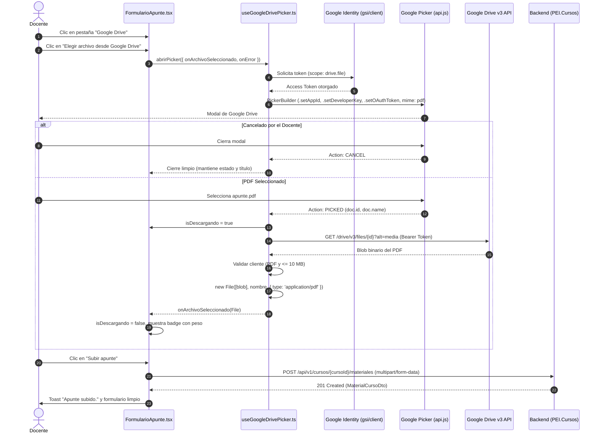

# ESPECIFICACIÓN TÉCNICA E INTEGRACIÓN: S3-CU-05 — GOOGLE DRIVE PICKER

> **Módulo:** Cursos (Frontend / Integración Externa)  
> **Issue Asociada:** [#242 (S3-CU-05)](https://github.com/Proyecto-Software-Equipo-404-FOUND/Tiza/issues/242)  
> **Rama de Trabajo:** `feature/S3-CU-05-integracion-google-drive`  
> **Target Consumers:** Docentes (Carga de apuntes PDF)  
> **Fecha:** Noviembre 2026  
> **Estado:** Implementado, Verificado con Pruebas Unitarias y Probado End-to-End  

---

## 1. CONTEXTO OPERATIVO Y DECISIONES TÉCNICAS (AI-to-AI)

Este documento condensa los acuerdos técnicos y arquitectónicos formalizados para la importación de apuntes desde Google Drive:

1. **Estrategia Frontend-Mediated (Estrategia A):**
   * El navegador del usuario interactúa directamente con los servidores de Google mediante **Google Identity Services (GIS)** y **Google Picker API**.
   * Al seleccionar el PDF, el cliente descarga el archivo en memoria (`fetch` con `alt=media`) y lo envía en formato estándar `multipart/form-data` al endpoint existente:
     `POST /api/v1/cursos/{cursoId}/materiales`
   * **Fundamento Arquitectónico:** Desacopla 100% el backend de `PEI.Cursos` respecto a APIs propietarias externas (Clean Architecture e Inversión de Dependencias). El backend permanece agnóstico al origen del archivo y reutiliza toda la infraestructura de validación (PdfPig, 10 MB, 30 páginas, texto seleccionable) y almacenamiento (`IAlmacenamientoArchivos`).

2. **Rechazo de Librerías Externas Abandonadas:**
   * Se descartaron paquetes npm como `react-google-drive-picker` (v1.2.2) porque utilizan la librería obsoleta `gapi.auth2` (dada de baja por Google en marzo de 2023) y no implementan la descarga del binario ni la configuración de `setAppId`.
   * Se implementó un hook nativo en TypeScript (`useGoogleDrivePicker.ts`) alineado a los estándares modernos de Google Identity Services (`google.accounts.oauth2`).

3. **Requisito Crítico `setAppId` (Resolución de Error 404):**
   * Al utilizar el scope de menor privilegio `https://www.googleapis.com/auth/drive.file`, Google exige configurar explícitamente `.setAppId(PROJECT_NUMBER)` en el `PickerBuilder`.
   * Sin este parámetro, Google no vincula el permiso temporal del usuario con el proyecto en Cloud Console, y la descarga posterior del binario responde con `404 Not Found`.

4. **Degradación Agraciada (Feature Flag):**
   * Si no están presentes `VITE_GOOGLE_CLIENT_ID`, `VITE_GOOGLE_API_KEY` o `VITE_GOOGLE_APP_ID` en el entorno, la UI oculta el selector de pestañas y muestra únicamente el input de archivo local, garantizando que el frontend funcione siempre sin dependencias externas obligatorias.

5. **Experiencia de Usuario y Manejo de Errores:**
   * **Pestañas:** *"Desde mi equipo"* y *"Google Drive"*. Al alternar pestañas se resetea el archivo elegido y sus errores, conservando intacto el campo *"Título"*.
   * **Cancelación Limpia:** Si el docente cancela el modal de Google, no se borra el título ni se lanzan errores.
   * **Ficha de Archivo:** Muestra nombre del PDF, tamaño formateado (`formatearTamano`) y botón para cambiar de archivo.
   * **Separación de Errores:** Errores de validación de negocio (no PDF o >10 MB) se muestran en línea (`errorArchivo`); fallos de red/OAuth/popup bloqueado se notifican mediante `useAviso('error', ...)`.

---

## 2. ARQUITECTURA DEL FLUJO



---

## 3. COMPONENTES Y ARCHIVOS INVOLUCRADOS

* **`frontend/.env.example`:**  
  Documenta las 3 variables de entorno (`VITE_GOOGLE_CLIENT_ID`, `VITE_GOOGLE_API_KEY`, `VITE_GOOGLE_APP_ID`).
* **`frontend/src/vite-env.d.ts`:**  
  Tipado estricto en `ImportMetaEnv` para autocompletado y validación de tipos.
* **`frontend/src/features/cursos/hooks/useGoogleDrivePicker.ts`:**  
  Hook personalizado con carga perezosa de scripts (`api.js` y `gsi/client`), autenticación OAuth 2.0, configuración del Picker con `setAppId`, descarga con `fetch` a `File` y validación temprana.
* **`frontend/src/features/cursos/components/FormularioApunte.tsx`:**  
  Componente UI actualizado con selector dual de pestañas, degradación agraciada, indicador de carga en descarga y preservación de estado.
* **`frontend/src/features/cursos/components/FormularioApunte.test.tsx`:**  
  Suite completa de 19 tests en Vitest cubriendo flujos locales, de Drive, cancelación, errores y feature flag.
* **`frontend/src/features/cursos/hooks/useGoogleDrivePicker.test.ts`:**  
  Tests unitarios del hook verificando disponibilidad de variables de entorno y fallos de configuración.

---

## 4. VARIABLES DE ENTORNO LOCALES (`frontend/.env.local`)

```env
# Google Drive Picker (Local) - Origen: http://localhost:3000
VITE_GOOGLE_CLIENT_ID=xxxxxxxxxxxx-xxxxxxxxxxxxxxxx.apps.googleusercontent.com
VITE_GOOGLE_API_KEY=AIzaSyXXXXXXXXXXXXXXXXXXXXXXXXXXXXX
VITE_GOOGLE_APP_ID=123456789012
```

> **Configuración en Google Cloud Console:**
> * **Orígenes autorizados de JavaScript:** `http://localhost:3000` *(sin barra al final)*.
> * **Pantalla de consentimiento:** Modo Testing con usuarios de prueba autorizados.
> * **Restricciones de API Key:** Limitada a Google Picker API y origen web `http://localhost:3000/*`.

---

## 5. GUÍA RÁPIDA DE DEFENSA ACADÉMICA

1. **¿Por qué no se modificó el backend de `PEI.Cursos`?**  
   *Por Clean Architecture y desacoplamiento.* El servidor no debe tener dependencias de terceros para almacenamiento de usuarios. La recepción de un `File` HTTP estándar (`multipart/form-data`) mantiene al backend 100% puro, reutilizando invariantes, validaciones con PdfPig y persistencia sin migraciones de base de datos.
2. **¿Por qué un hook propio y no una librería de npm?**  
   *Por obsolescencia y deuda técnica.* Las librerías existentes (como `react-google-drive-picker`) fueron abandonadas hace 4 años y emplean `gapi.auth2` (deprecada y dada de baja por Google). Nuestro hook nativo usa Google Identity Services (GIS), no añade dependencias externas y resuelve el requisito obligatorio de `setAppId`.
3. **¿Qué función cumple `setAppId`?**  
   Al emplear el permiso estricto de menor privilegio `drive.file`, Google exige vincular el Picker con el Project Number. De omitirse, Google no enlaza el permiso temporal y la descarga del PDF devuelve `404 Not Found`.
